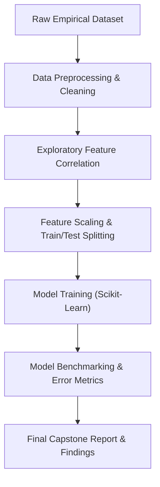

<p align="center">
  
</p>

<p align="center">
  
  
  
  
</p>

<a id="overview"></a>
## 📖 Executive Summary & Overview

The transition from exploratory data analysis to predictive machine learning requires rigorous mathematical hygiene: handling multicollinearity, scaling numeric features, encoding categorical variables, and evaluating models with non-leaking cross-validation protocols.

The **Data Science Semester 2 Capstone Project** (`IDS-Project-SEM-2`) delivers an end-to-end data science study undertaken at Alliance University. The project synthesizes comprehensive feature engineering, statistical hypothesis testing, model training (regression and classification algorithms), and validation reporting in `IDS Project.ipynb` and `IDS project report.docx`.

<a id="toc"></a>
## 📑 Table of Contents

- [📖 Executive Summary & Overview](#overview)
- [🎯 Key Features & Capabilities](#features)
- [🏗️ System Architecture & Pipeline](#architecture)
- [🛠️ Tech Stack Breakdown](#tech-stack)
- [⚙️ Reproducible Quickstart & Setup](#setup)
- [📁 Project Directory Layout](#project-layout)
- [👨‍💻 Author & Contributions](#author)

<a id="features"></a>
## 🎯 Key Features & Capabilities

- **End-to-End Data Pipeline:** Systematic raw data ingestion, imputation of missing entries, and outlier mitigation via Z-score / IQR.
- **Multivariate Exploratory Analysis:** Pairwise feature correlations, covariance matrices, and target distribution visualizations.
- **Feature Transformation:** One-hot encoding for nominal categories, ordinal mappings, and MinMax/Standard feature scaling.
- **Supervised Model Evaluation:** Comparative model benchmarking evaluating Mean Squared Error (MSE), $R^2$ scores, precision, and recall.

<a id="architecture"></a>
## 🏗️ System Architecture & Pipeline



<a id="tech-stack"></a>
## 🛠️ Tech Stack Breakdown

| Component | Library | Purpose |
| :--- | :--- | :--- |
| **Data Engine** | Pandas | High-performance tabular data structures |
| **Numerical Processing** | NumPy | Mathematical array transformations and vector operations |
| **Visual Diagnostics** | Matplotlib / Seaborn | Distribution plots, heatmaps, and residuals |
| **Machine Learning** | Scikit-learn | Preprocessing scalers, regression models, cross-validation |
| **Notebook Runtime** | Jupyter Notebook | Interactive research lab |

<a id="setup"></a>
## ⚙️ Reproducible Quickstart & Setup

### Prerequisites
- Python 3.8+ with virtual environment

```bash
# 1. Clone repository
git clone https://github.com/Amaraiah11/IDS-Project-SEM-2.git
cd IDS-Project-SEM-2

# 2. Setup virtual environment
python -m venv venv
venv\Scripts\activate   # Windows

# 3. Install required packages
pip install pandas numpy matplotlib seaborn scikit-learn jupyter

# 4. Open notebook
jupyter notebook "IDS Project.ipynb"
```

<a id="project-layout"></a>
## 📁 Project Directory Layout

```text
IDS-Project-SEM-2/
├── IDS project report.docx    # Formal comprehensive capstone project report
├── IDS Project.ipynb          # Computational data science notebook
└── README.md                  # Project overview and technical documentation
```

<a id="author"></a>
## 👨‍💻 Author & Contributions

This project is developed and maintained with high technical rigour by **Amaraiah C**, Software Engineer and Data Analytics Practitioner studying Bachelor of Computer Applications (BCA) at Alliance University.

- 🌐 **GitHub:** [@Amaraiah11](https://github.com/Amaraiah11)
- 💼 **LinkedIn:** [Connect on LinkedIn](https://www.linkedin.com/in/amaraiah-c/)
- 📧 **Institutional Contact:** `camaraiahBCA24@ced.alliance.edu.in`

### 🤝 Contribution Guidelines
Contributions, bug reports, and architectural discussions are welcome!
1. **Fork** the repository: `https://github.com/Amaraiah11/IDS-Project-SEM-2`
2. **Branch**: `git checkout -b feature/your-feature-name`
3. **Commit**: `git commit -m "feat: enhance feature logic"`
4. **Push**: `git push origin feature/your-feature-name`
5. **Open Pull Request** against the `main` branch.

---

<p align="center">
  <b>⭐ If this codebase or documentation assisted your engineering workflows, please star the repository! ⭐</b>
</p>

<p align="center">
  
</p>
