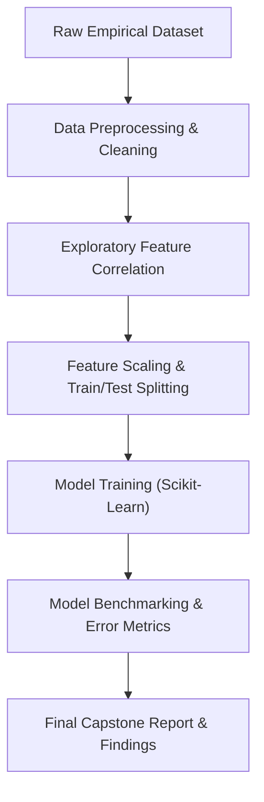

# 🎯 Data Science Capstone Project — Supervised Machine Learning & Predictive Modeling

<p align="center">
  
</p>

<p align="center">
  <b>End-to-End Data Science Project: Multicollinearity Diagnostics, Feature Transformations, Regression/Classification Benchmarks, and Academic Capstone Reporting.</b>
</p>

<p align="center">
  
  
  
  
</p>

<p align="center">
  
</p>

---

<a id="table-of-contents"></a>
## 📌 Table of Contents

- [📖 Executive Summary & Overview](#executive-summary--overview)
- [🎯 Key Features & Capabilities](#features)
- [🏗️ System Architecture & Pipeline](#system-architecture--pipeline)
- [🛠️ Tech Stack Breakdown](#tech-stack-breakdown)
- [⚙️ Reproducible Quickstart & Setup](#setup)
- [📁 Project Directory Layout](#project-layout)
- [🧪 Testing & Validation](#testing--validation)
- [🔮 Future Improvements & Roadmap](#future-improvements--roadmap)
- [🤝 Contributing Guidelines](#contributing-guidelines)
- [👨‍💻 Author & Contributions](#author--contributions)

---

<a id="executive-summary--overview"></a>
## 📖 Executive Summary & Overview

The transition from exploratory data analysis to predictive machine learning requires rigorous mathematical hygiene: handling multicollinearity, scaling numeric features, encoding categorical variables, and evaluating models with non-leaking cross-validation protocols.

The **Data Science Semester 2 Capstone Project** (`IDS-Project-SEM-2`) delivers an end-to-end data science study undertaken at Alliance University by **Amaraiah C**. The project synthesizes comprehensive feature engineering, statistical hypothesis testing, model training (regression and classification algorithms), and validation reporting in `IDS Project.ipynb` and `IDS project report.docx`.

---

<a id="key-features--capabilities"></a>
## 🎯 Key Features & Capabilities

### 🧼 1. Data Cleaning & Normalization
- Handling missing data, removing outliers via IQR bounds, and normalizing numeric covariates with `StandardScaler`.

### 📊 2. Multivariate Exploratory Analysis
- Correlation heatmaps, pairplots, and feature-target relationship curves.

### 🤖 3. Supervised Model Benchmarking
- Evaluating multiple regression and classification baselines with Mean Squared Error (MSE), $R^2$, and F1-Scores.

---

<a id="system-architecture--pipeline"></a>
## 🏗️ System Architecture & Pipeline



---

<a id="tech-stack-breakdown"></a>
## 🛠️ Tech Stack Breakdown

| Component | Library | Purpose |
| :--- | :--- | :--- |
| **Data Engine** | Pandas | High-performance tabular data structures |
| **Numerical Processing** | NumPy | Mathematical array transformations and vector operations |
| **Visual Diagnostics** | Matplotlib / Seaborn | Distribution plots, heatmaps, and residuals |
| **Machine Learning** | Scikit-learn | Preprocessing scalers, regression models, cross-validation |
| **Notebook Runtime** | Jupyter Notebook | Interactive research lab |

---

<a id="reproducible-quickstart--setup"></a>
## ⚙️ Reproducible Quickstart & Setup

### Prerequisites
- Python 3.8+ with virtual environment

```bash
# 1. Clone repository
git clone https://github.com/Amaraiah11/IDS-Project-SEM-2.git
cd IDS-Project-SEM-2

# 2. Setup virtual environment
python -m venv venv
venv\Scripts\activate   # Windows

# 3. Install required packages
pip install pandas numpy matplotlib seaborn scikit-learn jupyter

# 4. Open notebook
jupyter notebook "IDS Project.ipynb"
```

---

<a id="project-directory-layout"></a>
## 📁 Project Directory Layout

```text
IDS-Project-SEM-2/
├── IDS project report.docx    # Formal comprehensive capstone project report
├── IDS Project.ipynb          # Computational data science notebook
└── README.md                  # Project overview and technical documentation
```

---

<a id="testing--validation"></a>
## 🧪 Testing & Validation

- Data splits enforced strictly with `train_test_split(..., random_state=42)` preventing training set data leakage into validation benchmarks.

---

<a id="future-improvements--roadmap"></a>
## 🔮 Future Improvements & Roadmap

- [ ] Incorporate Gradient Boosted Decision Trees (XGBoost / LightGBM).
- [ ] Add SHAP (SHapley Additive exPlanations) for global feature interpretability.

---

<a id="author--contributions"></a>
## 👨‍💻 Author & Contributions

This project is developed and maintained with rigorous engineering standards by **Amaraiah C**, Software Developer and Applied Data Analytics Practitioner studying Bachelor of Computer Applications (BCA) at Alliance University, Bangalore.

- 🌐 **GitHub Profile:** [@Amaraiah11](https://github.com/Amaraiah11)
- 💼 **LinkedIn Profile:** [Connect on LinkedIn](https://www.linkedin.com/in/amaraiah-c/)
- 📧 **Institutional Email:** `camaraiahBCA24@ced.alliance.edu.in`

### 🤝 Contributing Guidelines
Contributions, bug reports, and architectural discussions are welcome!
1. **Fork** the repository: `https://github.com/Amaraiah11/IDS-Project-SEM-2`
2. **Create a Feature Branch:**
   ```bash
   git checkout -b feature/your-feature-name
   ```
3. **Commit Your Enhancements:**
   ```bash
   git commit -m "feat: enhance feature logic"
   ```
4. **Push to Your Branch:**
   ```bash
   git push origin feature/your-feature-name
   ```
5. **Open a Pull Request** against the `main` branch.

---

<p align="center">
  <b>⭐ If this codebase or documentation assisted your engineering workflows, please star the repository! ⭐</b>
</p>

<p align="center">
  
</p>
